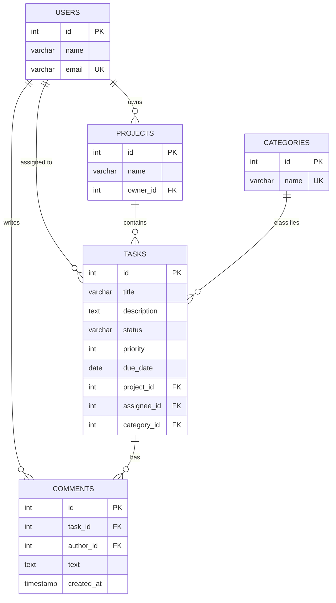
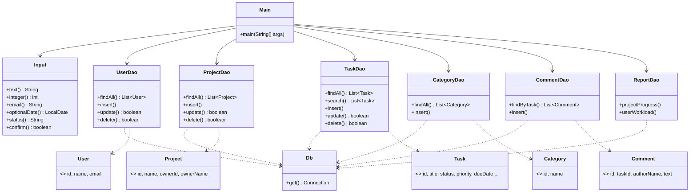

# Task Manager — курсовой проект (учёт задач)

Консольное Java-приложение с меню. Данные хранятся во встроенной базе H2, доступ через JDBC.

## Возможности

- Полный CRUD: **пользователи**, **проекты**, **задачи**
- Комментарии к задачам (добавить, посмотреть), добавление категорий
- Поиск задач по части названия и (по желанию) по статусу
- Отчёты (JOIN + агрегаты): прогресс по проектам, нагрузка по пользователям
- Валидация ввода: обязательные поля, длина, формат email, приоритет 1–5, дата, статус; ошибки БД (дубликат email, несуществующий id) показываются понятным сообщением

## Запуск

Устанавливать базу данных не нужно: используется встроенная СУБД **H2** (совместима с PostgreSQL-синтаксисом).

1. Открыть папку проекта в IntelliJ IDEA (Maven сам скачает H2).
2. Консольное меню: запустить `com.example.taskapp.Main`.
3. Веб-версия: запустить `com.example.taskapp.WebMain`: браузер откроется сам на http://localhost:8080 (если нет, открыть вручную)
4. При первом запуске создаются таблицы (`schema.sql`) и тестовые данные (`seed.sql`). Данные хранятся в папке `data/`. Чтобы начать с чистой базы, удалить папку `data`.

Консольное меню и сайт работают с одной и той же базой и теми же DAO-классами. Файлы `sql/schema.sql` и `sql/seed.sql` — те же скрипты, их можно выполнить и в PostgreSQL.

## Веб-версия

`WebMain` — встроенный HTTP-сервер из JDK (`com.sun.net.httpserver`), без Spring и дополнительных библиотек.
Он отдаёт страницу `static/index.html` и JSON API (`/api/users`, `/api/projects`, `/api/tasks`, `/api/categories`, `/api/reports`).
Поиск и отчёты выполняются SQL-запросами на сервере, ввод проверяется и на сервере, и в базе.

## ER-диаграмма

## Нормализация (3NF)

- **1NF:** все значения атомарные, у каждой таблицы есть первичный ключ, нет повторяющихся групп.
- **2NF:** первичные ключи простые (один столбец `id`), поэтому частичных зависимостей нет.
- **3NF:** нет транзитивных зависимостей. Имя проекта, имя исполнителя и название категории не дублируются в `tasks`, там хранятся только `project_id`, `assignee_id`, `category_id`; сами данные лежат в своих таблицах и получаются через JOIN.

## Диаграмма классов

## Структура проекта

| Пакет | Роль |
|---|---|
| `model` | данные (User, Project, Task, Category, Comment) — неизменяемые `record` |
| `dao` | весь SQL: по одному классу на таблицу + отчёты |
| `util` | подключение к БД (`Db`) и ввод с валидацией (`Input`) |
| `Main` | консольное меню, вызывает только DAO |
| `WebMain` | веб-версия: HTTP-сервер и JSON API поверх тех же DAO |
